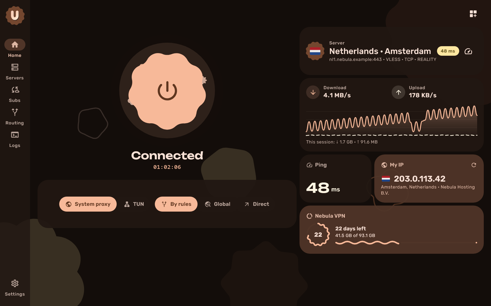
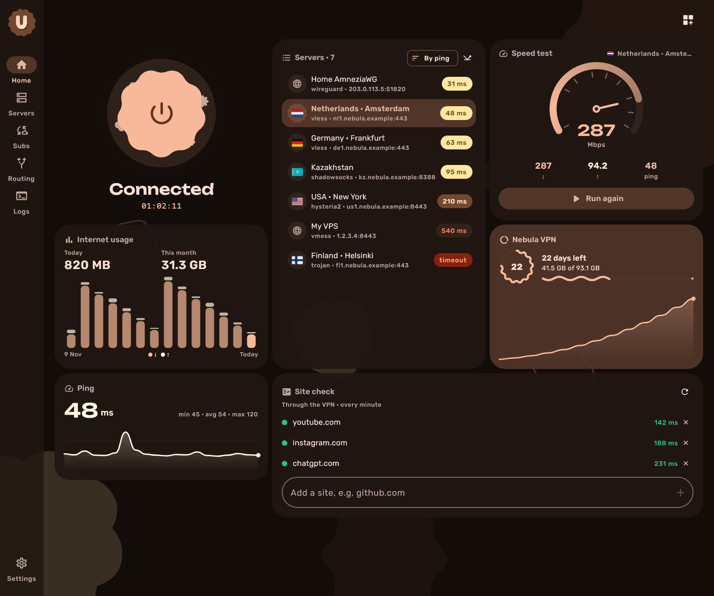
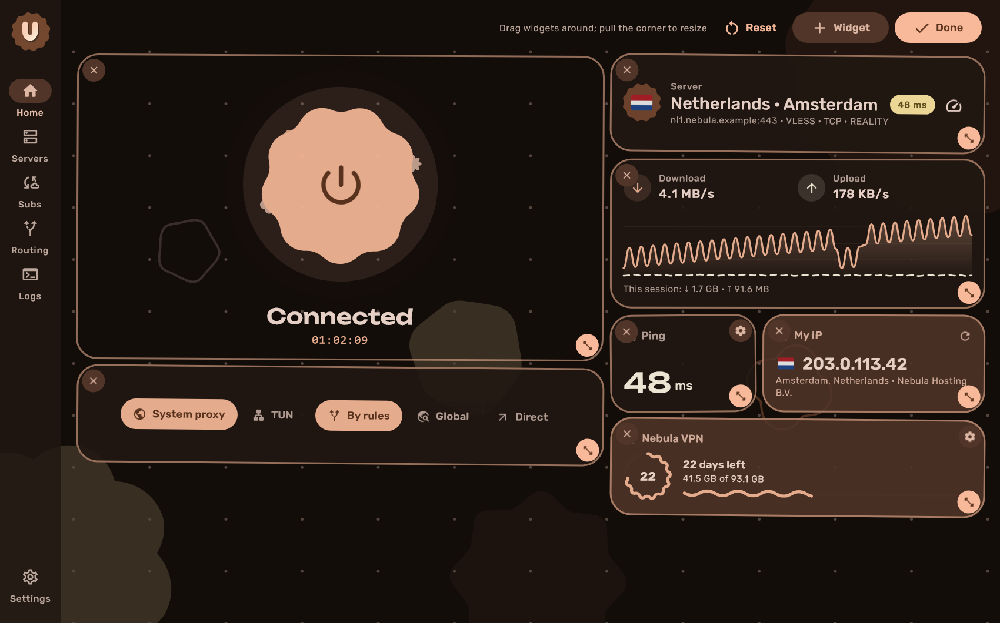
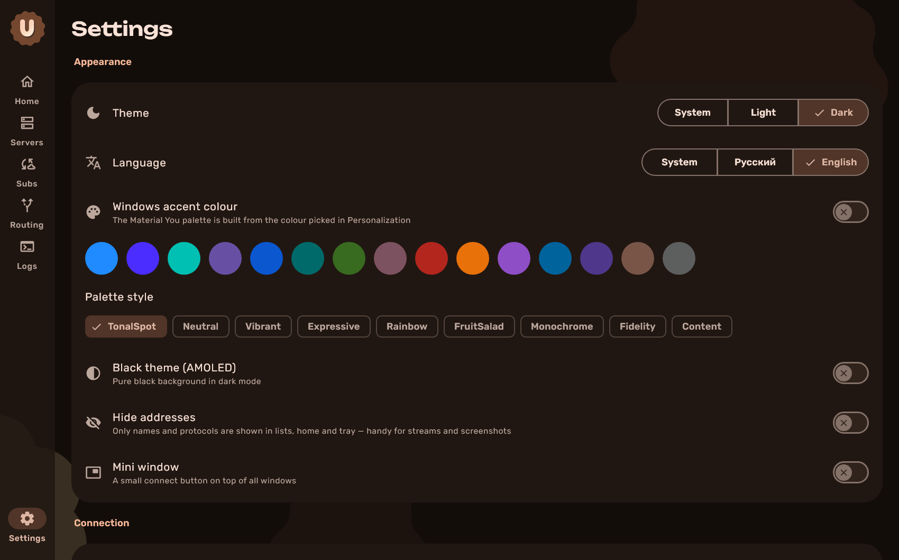

# Uplinx


**English** · [Русский](README.ru.md)

A proxy client for Windows built with **Material You 3 Expressive** and powered by **Xray-core**.
It handles subscriptions, share links, Amnezia keys, WireGuard / AmneziaWG, Clash, sing-box and Xray configs, in system proxy or TUN mode.

<p>
  
  
</p>
<p>
  
</p>
<p>
  
</p>
<p>
  
  
</p>
<p>
  
  
</p>

## Download

Get the installer (`.exe` / `.msi`) or the portable `.zip` from [Releases](https://github.com/alexkonstich-byte/uplinx/releases/latest).
Java is bundled, and the installer doesn't need administrator rights. The Xray core, geo databases and wintun are downloaded on first connect.

## Features

**Widget home screen.** Press *Customize home*, then:
- drag widgets around: they snap to a grid and push others out of the way;
- resize them by the corner;
- add or remove them.

Available widgets:
- **Connect button.**
- **Speed test:** speedometer with download, upload and ping.
- **Servers:** every server with its ping, sorting, and one click to switch.
- **Ping:** with a live chart through the tunnel.
- **My IP.**
- **Site check:** add sites and see whether they open through the VPN, and how fast.
- **Internet usage:** daily bars for two weeks, plus today and this month.
- **Speed chart.**
- **Subscription:** days and GB left, with an optional chart of how the traffic was spent.
- **Modes, current server and session timer.**

Widgets with options get a ⚙ in edit mode. The layout is saved.

**Own title bar.** The Windows frame is replaced by one in the app's own colours, with the logo, a live connection status and its own window buttons. You can drag it, double-click to maximize and resize from any edge.

**Split tunnelling.** Choose to send *only chosen apps* through the VPN, or *everything except them*. Pick from running programs (with their icons) or any `.exe`.

**Speed test.** Download, upload and ping of **any server without connecting to it**, using a throwaway core bound to your network adapter. It has its own speedometer widget and a *Speed test* item in every server's menu.

**Windows notifications.** You get notified when Uplinx connects or disconnects, on errors and dropped connections, when a subscription ends within 3 days or runs out of traffic, and when a new version comes out. Each kind can be turned off.

**Import anything.**
- `vless://`, `vmess://`, `trojan://`, `ss://`, `socks://`, `http(s)://`, `hy2://` / `hysteria2://`, `wireguard://` links;
- **Amnezia** `vpn://` keys (AWG, WireGuard and Xray containers);
- WireGuard and **AmneziaWG** `.conf` files;
- **Xray JSON**, including **balancers and chains** (run as a whole config);
- **Clash / Mihomo YAML** with rules, **sing-box JSON**, JSONC, JSON arrays of links;
- `host:port:user:pass` proxy lists, nested subscriptions, Happ-compatible routing profiles;
- base64 or plain subscriptions.

You can import with Ctrl+V anywhere, drag & drop, *Open file…*, **a QR code on screen** or in an image, or a `uplinx://add/<link>` deep link (asks for confirmation).

**Subscriptions.**
- Reads `subscription-userinfo` (traffic and expiry), `profile-title`, `profile-update-interval`, `profile-logo`, `support-url`, `announce` and the `routing` profile.
- Updates automatically, pins, and flags expired or used-up subscriptions.
- If a panel answers *"App not supported"*, Uplinx retries as another client (Happ, v2rayN, sing-box, Clash), remembers the one that worked, and sends device headers (`x-hwid`…) for panels with device limits.

**Modes.**
- *System proxy* (WinINet). The previous proxy settings are saved and restored, even after a crash.
- *TUN* via Xray's built-in `tun` inbound (wintun) with automatic routes and WFP DNS-leak protection.

**Routing.** Three modes: by rules, global and direct.
- Presets: block ads, Russian sites direct, proxy only blocked sites (runetfreedom geo).
- Custom rules by domain, IP, geosite, geoip, **process / app** or port.

**Latency.** A real URL test of every server through a throwaway Xray process, without touching system settings.
- Parallelism adapts to the list size and reachable servers are tested first.
- Balancers show their best member.
- Old values are struck through while a new test runs.

**AmneziaWG.** Configs with only Jc/Jmin/Jmax run inside Xray (`noise` mask), with routing. Full AWG (S1/S2/H1–H4) runs through the official AmneziaWG engine.

**Material You.**
- The palette comes from the Windows accent colour (or your own), with 9 palette styles and an AMOLED option.
- The background is alive: M3 Expressive shapes morph and drift, with parallax between screens.
- The connect button always spins, and shapes orbit it while connected.
- The Windows 11 title bar is themed, and flags appear as avatars.
- Fonts: **Unbounded** for headlines and **Rubik** for text.

**More.**
- English and Russian UI, switchable live;
- mini always-on-top window, tray, autostart;
- QR codes and link / `.conf` export;
- server editor (including raw Xray JSON);
- logs, live speed chart, all-time traffic stats;
- plain-language errors with details.

**Updates.**
- Checks GitHub Releases on start and every 6 hours.
- Shows the full release notes before updating and installs in one click.
- The portable build updates itself.
- *What's new* appears after an update.

## Build

Requires JDK 25.

```
gradlew run                  # run
gradlew test                 # parser and config-generator tests
gradlew packageExe           # .exe installer (packageMsi for .msi)
```

UI screenshots are rendered offscreen with demo data, with no window and no connection:

```
gradlew screenshots -Dmyproxy.home=<temp dir> -Dshots.out=<dir> -Dshots.lang=en
```

Releases are built by GitHub Actions on a `v*` tag: `.exe`, `.msi`, portable `.zip` and `SHA256SUMS.txt`.

## Stack & credits

Kotlin, Compose Multiplatform Desktop, Material 3 Expressive, MaterialKolor, kotlinx.serialization, SnakeYAML, JNA, ZXing, [Xray-core](https://github.com/XTLS/Xray-core).
Flags: [Twemoji](https://github.com/jdecked/twemoji) (CC-BY 4.0). Fonts: [Unbounded](https://github.com/googlefonts/unbounded) and [Rubik](https://github.com/googlefonts/rubik) (SIL OFL 1.1).
