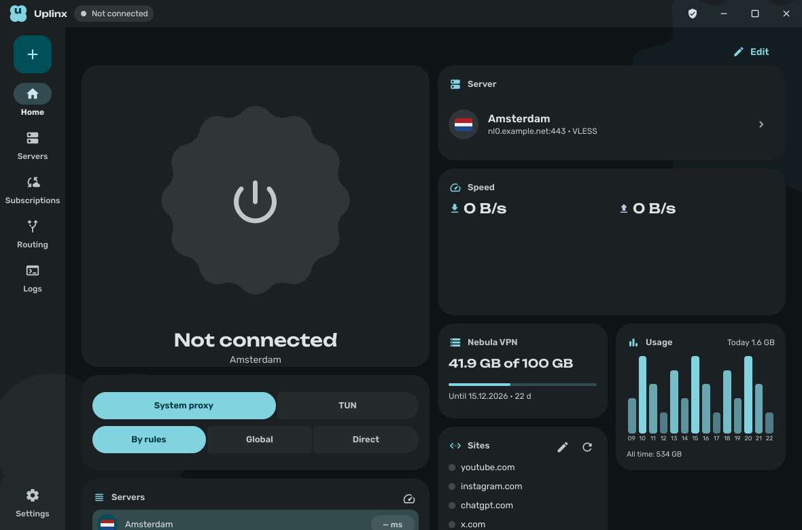
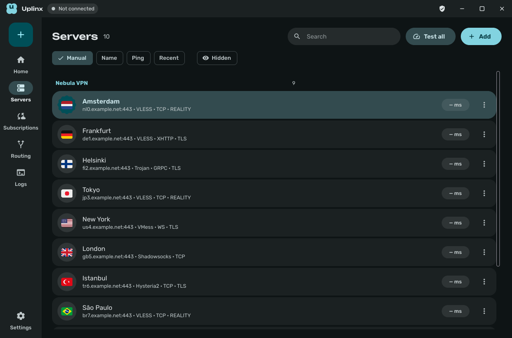
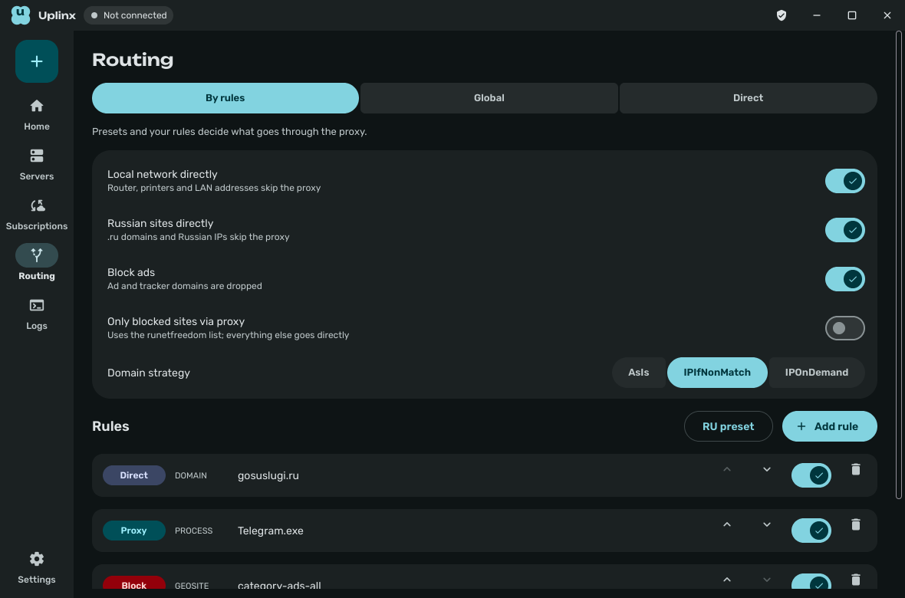

# Uplinx


[English](README.md) · **Русский**

Быстрый и лёгкий прокси-клиент для Windows в стиле **Material You 3 Expressive** на ядре **Xray-core**.
Написан на Rust со [Slint](https://slint.dev): около **10 МБ памяти** и **0% CPU** в простое.

<p>
  
  
</p>
<p>
  
  
</p>

## Скачать

`Uplinx-<версия>.msi` или портативный `Uplinx-<версия>-portable-win64.zip` —
в [релизах](https://github.com/alexkonstich-byte/uplinx/releases/latest).
Установщику не нужны права администратора. Xray-core, гео-базы и Wintun скачиваются при первом подключении.

## Возможности

**Импорт чего угодно** — вставкой, файлом, из буфера или QR-кодом с экрана:
- ссылки `vless`, `vmess`, `trojan`, `ss`, `socks`, `http(s)`, `hy2` / `hysteria2`, `wireguard`;
- подписки (обычные и base64), вложенные подписки, JSON-массивы ссылок, пулы прокси (`ip:port[:user:pass]`);
- конфиги WireGuard и AmneziaWG, ключи Amnezia `vpn://`;
- Xray JSON (балансеры и цепочки сохраняются целиком), sing-box, Clash / Mihomo YAML с правилами, JSONC;
- профили маршрутизации Happ и ссылки `uplinx://add/…`.

**Подписки.** Трафик и срок (`subscription-userinfo`), название, интервал обновления, поддержка и сайт, объявления,
логотипы, профили и правила маршрутизации от панели, заголовок HWID, история расхода.
Если панель отвечает «App not supported», Uplinx пробует представиться другими клиентами и запоминает удачный вариант.

**Подключение.**
- Системный прокси (прежние настройки сохраняются и восстанавливаются даже после сбоя) или TUN для всех программ.
- Конфиги AmneziaWG с обфускацией S/H — через официальный сервис AmneziaWG.
- Маршрутизация: по правилам / глобально / напрямую; пресеты для LAN, российских сайтов, рекламы и списков runetfreedom;
  свои правила по домену, IP, geosite, geoip, процессу и порту; раздельное туннелирование по программам.

**Замеры.** Настоящий пинг через отдельный Xray, привязанный к физическому адаптеру (чужой VPN его не подделает),
включая участников балансера; распознавание TUN-адаптеров, подделывающих TCP; тест скорости; проверка сайтов.

**Главный экран из виджетов** на сетке в 12 колонок: подключение, сервер, режимы, скорость, пинг, ваш IP, остаток
подписки, серверы, сессия, сайты, тест скорости, трафик. Их можно двигать, менять размер, добавлять и убирать.

**А ещё:** цвета из акцента Windows или свои, светлая / тёмная тема, английский / русский, трей с уведомлениями,
мини-окно, автозапуск, логи с фильтрами, редактор серверов, QR-код сервера, обновления из GitHub Releases
(тихое обновление MSI или портативной версии, загрузка в фоне).

## Сборка

```
cargo test --release
cargo build --release
```

Workflow релиза (`.github/workflows/release.yml`) собирает MSI (WiX) и портативный zip на каждый тег `v*`.
