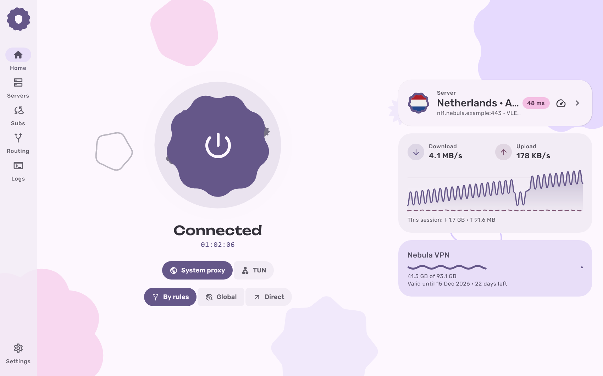

# MyProxy

[English](README.md) · **Русский**

Прокси-клиент для Windows в стиле **Material You 3 Expressive**. Работает на ядре **Xray-core**.
Подписки, ссылки, ключи Amnezia, WireGuard и AmneziaWG, системный прокси и TUN.

<p>
  
  
</p>
<p>
  
  
</p>
<p>
  
  
</p>

## Возможности

**Импорт всего подряд.** Поддерживаются:
- ссылки `vless://`, `vmess://`, `trojan://`, `ss://`, `socks://`, `http(s)://`, `hy2://` / `hysteria2://`, `wireguard://`;
- ключи **Amnezia** `vpn://`: из них берутся контейнеры AWG, WireGuard и Xray;
- файлы `.conf` WireGuard и **AmneziaWG**;
- **JSON-конфиги Xray**, одиночные и массивом, включая **балансировщики и цепочки** (такой конфиг запускается целиком);
- **Clash/Mihomo YAML** вместе с правилами, **sing-box JSON**, JSONC, JSON-массивы ссылок;
- пулы прокси `host:port:user:pass`, вложенные подписки, профили маршрутизации в формате Happ;
- подписки в base64 или обычным списком.

Импортировать можно через Ctrl+V в любом месте окна, перетаскиванием файлов в окно, через «Открыть файл…», **QR-кодом с экрана** или из картинки, или по диплинку `myproxy://add/<ссылка>` (с подтверждением).

## Скачать

Установщик и портативная версия лежат в [Releases](https://github.com/alexkonstich-byte/myproxy/releases/latest).

**Подписки.** Учитываются заголовки `subscription-userinfo` (трафик и срок действия), `profile-title`, `profile-update-interval`, `support-url` и `announce`. Подписки обновляются автоматически, а при обновлении выбранный сервер сохраняется.

**Режимы.**
- *Системный прокси* (WinINet). Прежние настройки прокси сохраняются и восстанавливаются даже после падения приложения.
- *TUN* через встроенный `tun` inbound Xray (wintun) с `autoSystemRoutingTable` и WFP-защитой от утечек DNS.

**Маршрутизация.** Три режима: по правилам, глобальный, напрямую. Есть пресеты: блок рекламы, РФ напрямую, «через прокси только заблокированное» на гео-базах runetfreedom. Свои правила задаются по домену, IP, geosite, geoip, **процессу** или порту.

**AmneziaWG.** Конфиги только с Jc/Jmin/Jmax работают прямо в Xray (маска `noise`), с маршрутизацией. Полный AWG с S1/S2/H1–H4 запускается через официальный движок AmneziaWG как туннельная служба.

**Пинг.** Реальный URL-тест каждого сервера во временном Xray, без изменения системных настроек. Параллельность подстраивается под размер списка, у балансировщика показывается лучший участник, старое значение зачёркивается на время замера.

**Серверы и подписки.**
- сортировка по имени, пингу или последнему использованию;
- скрытие серверов (переживает обновления) и маскировка адресов;
- флаги Twemoji;
- логотипы подписок из `profile-logo`, закрепление, анонсы и ссылки сервиса;
- метка у истёкших подписок;
- выбор клиента для панелей: Happ, INCY или без маскировки.

**Остальное.**
- мини-окно поверх всех окон;
- выбор приложений для правил;
- ошибки понятными словами;
- QR-коды, экспорт ссылок и `.conf`, просмотр сгенерированного конфига, редактор сервера (в том числе сырого Xray JSON);
- логи ядра, скорость и график, статистика трафика за всё время;
- трей, автозапуск, проверка обновлений.

**Языки.** Русский и English, переключаются на лету в настройках.

**Обновления.** Приложение проверяет GitHub Releases при запуске и каждые 6 часов, показывает список изменений и ставит обновление в один клик. Портативная версия обновляет себя сама. После обновления открывается экран «Что нового».

**Подписки «App not supported».** Если панель не узнала клиента, MyProxy сам подбирает User-Agent (Happ, v2rayN, sing-box, Clash) и отправляет заголовки устройства для панелей с лимитом устройств.

**Material You.** Живой фон из фигур M3 Expressive с параллаксом, всегда вращающаяся кнопка подключения с орбитой из фигурок, шапка окна Windows 11 в цветах темы. Палитра строится из акцентного цвета Windows (MaterialKolor) и меняется на лету. Можно выбрать свой цвет, один из 9 стилей палитры и AMOLED-тему. Используются компоненты M3 Expressive: морфинг фигур, LoadingIndicator, волнистые прогресс-бары, ButtonGroup, MotionScheme.expressive().

## Сборка

Нужен JDK 25.

```
gradlew run                  # запустить
gradlew test                 # тесты парсеров и генератора конфига
gradlew packageExe           # установщик .exe (packageMsi — .msi)
```

Ядро Xray, гео-базы и wintun скачиваются при первом подключении в `%APPDATA%\MyProxy\core`.
Для TUN и AmneziaWG нужны права администратора: приложение само предложит перезапуститься с ними.

Скриншоты рендерятся офскрин на демо-данных, без окна и без подключения:

```
gradlew screenshots -Dmyproxy.home=<временная папка> -Dshots.out=<папка>
```

## Стек

Kotlin, Compose Multiplatform Desktop, Material 3 (Expressive), MaterialKolor, kotlinx.serialization, SnakeYAML, JNA, ZXing, Xray-core.
Флаги — [Twemoji](https://github.com/jdecked/twemoji) (CC-BY 4.0).

Релиз собирается GitHub Actions по тегу `v*`: `.exe`, `.msi`, portable-zip и `SHA256SUMS.txt`.
